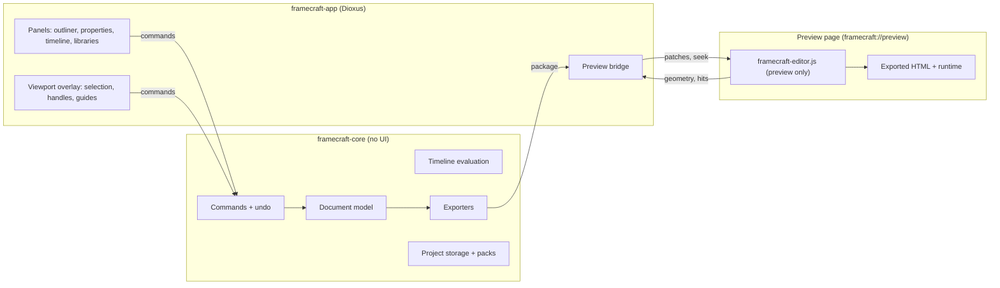

# FrameCraft editor design

Status: agreed, 2026-11-19. The decisions taken are listed at the end.

FrameCraft's editor is a desktop app for building broadcast and web graphics on a timeline, in the spirit of After Effects: you see the frame, select and move things in it, and animate them with keyframes. Its output is FRAME's export formats (SPX, OGraf, HTML banner), which `framecraft-core` already writes byte-for-byte like FRAME.

The UI test build (`framecraft-app`, step 4) settled the base:

- **Dioxus desktop.** The UI is Rust that renders HTML in the system web view.
- **The viewport is the export.** It shows the real exported page and runtime, served from memory on `framecraft://preview/…`, so what you see is what SPX, OGraf hosts and MENiAC Air will play.
- **Playback runs in the web view** (`requestAnimationFrame`), not as a Rust timer.

The test build also showed what feels clunky:

- **Every edit reloads the preview.**
- **The UI re-renders too much on small changes.**
- **There is no direct manipulation in the viewport.**

This design is mostly about fixing those three properly.

## Goals

1. **What you see is what plays.** The viewport renders with the same HTML and runtime as the export. Nothing is drawn by a second, imitating renderer.
2. **Immediate.** Dragging a layer, scrubbing and playing run at display rate (60 fps). Edits show within one frame.
3. **Every change can be undone,** and a crash never loses more than a few seconds of work.
4. **FRAME parity first.** FrameCraft opens FRAME projects and offers FRAME's features before adding new ones.
5. **Testable without a screen.** Editing logic lives in `framecraft-core`, where it is unit tested. The UI stays thin.

## Architecture



- **`framecraft-core`** owns the document and every change to it. It gains three modules: commands with undo, timeline evaluation (keyframe interpolation, the same as the runtime's), and project storage.
- **`framecraft-app`** is the UI. Panels and the viewport overlay never edit the document directly; they issue commands. They read state through Dioxus signals scoped narrowly, so a playhead move does not redraw the outliner.
- **The preview page** is the export package plus one extra script, `js/framecraft-editor.js`, added only to the preview. It is never part of an export. It patches the runtime's data in place, measures layer geometry and answers hit tests. The shipped runtime stays unchanged.

## Document, state and undo

| State | Lives in | Notes |
|---|---|---|
| Project (graphics, media, settings) | core `Project` | Saved to disk |
| Current graphic's `Document` | core | Edited only by commands |
| Selection, playhead, zoom, panel layout | app signals | Per window, not undoable (selection is restored with undo) |
| Undo history | core `History` | Per graphic |

**Commands.** Every edit is a `Command` in core:

```rust
pub trait Command {
    fn apply(&self, doc: &mut Document) -> Change;
    fn label(&self) -> String; // "Move Lower third", shown in Edit → Undo
}
```

`Change` tells the viewport how much to update (see the next section): `Pose`, `Layer(ids)` or `Rebuild`.

**Undo.** History keeps a snapshot of the `Document` before each command. A graphic is typically 20–200 KB, so 200 steps cost at most tens of MB, and snapshots make undo correct by construction (no inverse operations to get wrong). Continuous gestures coalesce: a drag sends many `SetPose` commands but records one undo step, closed on pointer-up. Typing in a field records one step per committed value.

**Saving.** Autosave writes a recovery copy every 30 s and on window blur. Explicit Save writes the project. Opening after a crash offers the recovery copy.

## Viewport: live updates without reloading

Every command returns one of three update tiers. The bridge applies the cheapest one that is correct.

| Tier | When | How | Cost |
|---|---|---|---|
| **Pose** | Transform, opacity, colors, keyframes, easing, cue times | The editor script patches `window.__ionframeSpx.animationTracks[i].base` / `.timeline` in place and calls the runtime's `__ionframeRefreshFrame()`. The runtime reads that data on every frame. | Under 1 ms. No reload. Works while dragging. |
| **Layer** | Fill, gradient, border, radius, shadow, font, text style, image source | Core renders that layer's markup (`html::layers_html` for one element). The editor script swaps the element and keeps its children, then patches its track. | A few ms. No reload. |
| **Rebuild** | Layers added, removed, reparented or reordered; type changes; particles, charts, QR, Lottie and video settings; scene size; scripts | Core builds a new preview package. The bridge loads it into a hidden second iframe, seeks it to the playhead, and swaps it in when it is ready. | 50–300 ms. No flicker, no blank frame. |

Charts, particles, Lottie and video use the Rebuild tier because the runtime sets them up once at start. A later step can add Layer-tier support per type where it matters.

**Correctness check.** In debug builds, after any Pose or Layer update, the bridge can rebuild in the background and compare the two pages' rendered DOM. Any difference is a bug in the fast path.

## Viewport: selection and direct manipulation

The viewport has two layers:

1. **The preview iframe,** which renders the frame.
2. **An overlay,** drawn by Dioxus as SVG above it: selection outlines, transform handles, the pivot, path and polygon points, safe areas, rulers, guides and snapping lines.

**Geometry comes from the rendered page.** After each frame the editor script measures the selected layers in the DOM (corner points through the full transform chain, including rotation, scale, pivot and parents) and posts them to the bridge. Handles therefore always sit exactly on what is drawn, including animated poses, path follow and text. The editor script also sends each layer's parent matrix, which core uses to turn a mouse drag into the layer's own coordinates.

**Hit testing.** A click is sent to the editor script, which uses `elementsFromPoint` and maps DOM ids (`shp_`, `txt_`, …) back to item ids. Core then applies FRAME's rules: locked layers can be selected but not moved, `lockChildren` selects the parent, and Alt cycles through stacked layers.

**Gestures:**

- **Move:** drag inside the outline. Shift constrains to an axis, and arrow keys nudge.
- **Resize:** edge and corner handles. Shift keeps the ratio, and Alt resizes from the center.
- **Rotate:** outside the corners, with Shift snapping to 15°.
- **Pivot:** drag the pivot point.
- **Polygon and path points:** with bezier handles, as in FRAME.

While dragging, each pointer move issues a Pose-tier command, so the preview updates every frame. Pointer-up closes the undo step. If auto-key is on and the property is animated, the command writes a keyframe at the playhead instead of the base value, as in FRAME.

## Timeline

- **Rows:** one per layer in outliner order, expandable to one lane per animated property. Cues get their own row.
- **Keyframes:** select, box-select, drag (with snapping to the playhead, other keys and cues), copy and paste, delete, and an easing menu with FRAME's 31 curves and icons.
- **Navigation:** zoom with Ctrl+wheel, pan, and a work area for loop playback.
- **Rendering:** rows are virtualized, so only visible rows exist in the DOM. The playhead and time display update through the bridge's fast path, not by re-rendering rows.
- **Values at the playhead:** core's timeline evaluation answers "what is X at 2.4 s", which the properties panel shows for animated fields and auto-key uses. It is tested against the runtime's interpolation on the reference graphics.

## Properties

FRAME's 14 tabs carry over:

- **Scene:** Scene, Script, Export.
- **Per layer:** Transform, Look, Text, Chart, QR, Particles, Lightning, Pattern, Lottie, Video, Modifiers.

Instead of hand-writing 6,000 lines of panel (FRAME's `ParametersPanel.svelte`), core describes each property once in a **property schema**:

- its field id and label;
- its type and range;
- which item types it applies to;
- the timeline lane that animates it, if any;
- its update tier.

One generic field renderer in the app draws numbers (with drag-to-scrub), colors, choices, toggles and text from that schema. Only genuinely special editors are custom widgets: gradient and curve ramps, polygon points, palettes, the script editor and the modifier stack.

The schema also drives the outliner icons, the timeline's lane names and the manual's property reference, so they cannot drift apart.

## Layout and panels

The first version keeps FRAME's arrangement, so FRAME users feel at home:

- **Center:** the viewport.
- **Right column:** the outliner above properties.
- **Bottom:** the timeline.
- **Top:** a toolbar.

Panel sizes are draggable and remembered. Fully dockable panels (as in After Effects) are a later step, not a requirement for parity.

Libraries open as panels or dialogs, as in FRAME:

- media, motions (the motion library with house motions);
- components;
- palettes and gradients;
- SVG shapes;
- particle sprites.

User libraries live in the platform's data folder: `~/.local/share/framecraft` on Linux, `%APPDATA%\FrameCraft` on Windows, `~/Library/Application Support/FrameCraft` on macOS.

## Files

- **Projects:** a project folder (decision 1): `Show.framecraft/` with `project.json`, `graphics/*.json`, `media/` and `.recovery/`.
- **FRAME interop:** open `.frameproject.zip` and `.framepack.zip`, and save as both, through `framecraft-core::pack`.
- **Export dialog:** SPX, OGraf, HTML banner, for one graphic or the whole project, with a list of any missing media before writing.
- **Built-in assets** (fonts, particle sprites, SVG shapes, stock gradients and palettes, Noto emoji animations) ship with the app once their licenses are confirmed (see `THIRD_PARTY.md`). Until then they load from a FRAME checkout.

## Performance targets

| What | Target |
|---|---|
| Playback, scrubbing, dragging | 60 fps, updates within 1 frame |
| Rebuild-tier update | under 300 ms, no blank frame |
| Open a 50-graphic project | under 1 s |
| Idle CPU | near zero (no polling loops) |

## Platforms

Linux is first, because it is the development machine.

Windows comes next and matters most for broadcast. There WebView2 is Chromium, the same engine family as SPX and CasparCG, so its preview is the closest match to playout.

macOS (WKWebView) follows.

Each platform runs the reference test suite. Rendering differences between web engines show up as a documented list, not a surprise on air.

## Milestones

| # | Milestone | Done when |
|---|---|---|
| M1 | Editor core: commands, undo, timeline evaluation, project storage | Unit tests cover every command. Timeline evaluation matches the runtime on all reference graphics. **Done 2026-11-19.** |
| M2 | Live viewport: editor script, Pose and Layer tiers, double-buffered rebuild | Editing X while playing never reloads. The rebuild never flickers. **Done 2026-11-19.** |
| M3 | Selection and transform gestures in the viewport, with undo | Move, resize, rotate and pivot on rotated and nested layers. **Done 2026-11-19.** |
| M4 | Outliner and property schema: Scene, Transform, Look, Text | Parity with FRAME for shapes and text. **Done 2026-11-19.** |
| M5 | Timeline editing: keyframes, easing, cues, auto-key | Parity with FRAME's timeline. |
| M6 | Remaining item types and modifiers | Every FRAME tab works. |
| M7 | Libraries and media | Media, motions, components, palettes, gradients, SVG shapes. |
| M8 | Scripts, cues, BOARD settings, export dialog | Every FRAME export option is reachable from the UI. |
| M9 | Packaging | Installers for Linux, Windows and macOS, plus auto-update. |

After M8, FrameCraft can replace FRAME in daily use, and frame.meniac.tech can be retired as planned.

## Decisions

Taken 2026-11-19:

1. **Project file format: a project folder.** `Show.framecraft/` holds `project.json`, one JSON file per graphic in `graphics/`, the media in `media/` and autosave copies in `.recovery/`. FRAME packs (`.frameproject.zip`, `.framepack.zip`) stay the exchange format.
2. **Platform after Linux: Windows.**
3. **Layout: FRAME's layout first,** with dockable panels later.
4. **Keyboard shortcuts: FRAME's set,** extended as features arrive.
